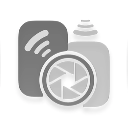
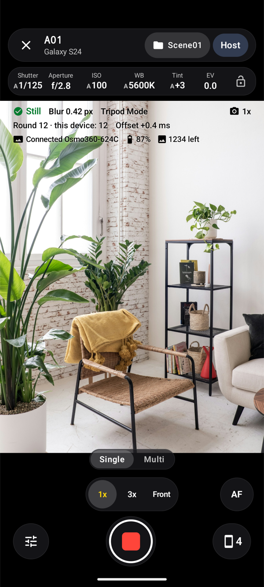
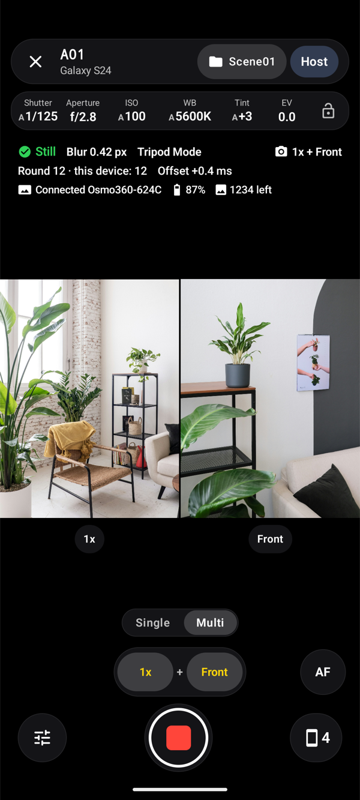
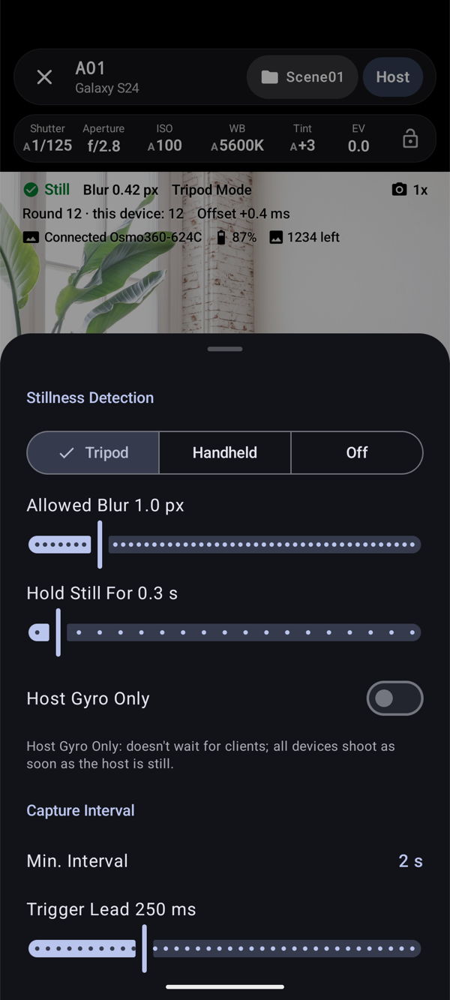
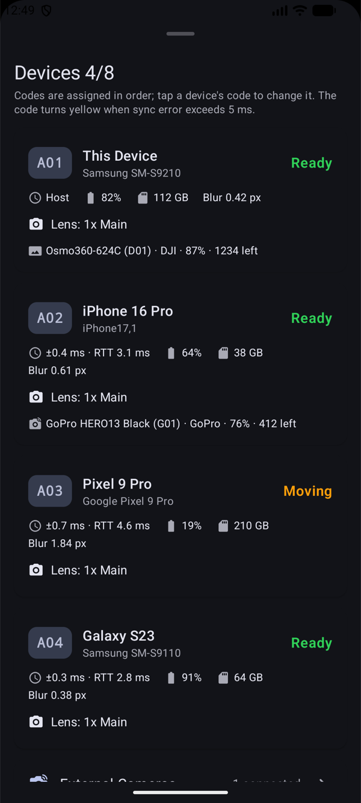

<p align="center">
  <picture>
    <source media="(prefers-color-scheme: dark)" srcset="docs/images/app-logo-dark.png">
    
  </picture>
</p>

<h1 align="center">TuttiCam · Android</h1>

<p align="center">
  <a href="README.md">简体中文</a> | <b>English</b>
</p>

<p align="center">
  <a href="https://github.com/dtpoi/TuttiCam-Android/releases/latest"></a>
  <a href="https://github.com/dtpoi/TuttiCam-Android/actions/workflows/ci.yml"></a>
  <a href="https://apps.apple.com/app/id6820396336"></a>
  <a href="https://www.TuttiCam.com"></a>
</p>

A group of phones **automatically takes interval shots at the same moment once every device is steady**. Designed for 3D Gaussian Splatting and large-scale timelapse.

This is the native Android port of the iOS app ([TuttiCam](https://apps.apple.com/app/id6820396336)). Its network protocol is compatible with iOS, so **Android phones and iPhones can take synchronized interval shots in the same session**, and both the Android and iOS versions can act as the host.

## Screenshots

| Single lens | Multi-lens | Stillness settings | Devices and external cameras |
| :---: | :---: | :---: | :---: |
|  |  |  |  |

## Features

| Feature&nbsp;&nbsp;&nbsp;&nbsp;&nbsp;&nbsp;&nbsp;&nbsp;&nbsp;&nbsp;&nbsp;&nbsp;&nbsp;&nbsp;&nbsp;&nbsp;&nbsp;&nbsp;&nbsp;&nbsp;&nbsp;&nbsp;&nbsp;&nbsp;&nbsp;&nbsp; | Details |
| --- | --- |
| Teams | One phone is the host, the others are clients. Devices on the same Wi‑Fi or hotspot find each other through NSD; up to 8 devices per session. Commands go over TCP, clock sync and status over UDP. A dropped client reconnects automatically after 1, 2, 4… up to 30 seconds |
| Remote mode | Turns the phone into an automatic interval trigger for connected external cameras; stillness detection and minimum interval can be set right in the middle of the screen |
| Precise clock sync | NTP-style round-trip measurement; each burst sends 30 probes and keeps the one with the shortest round trip. Device codes turn yellow when the sync error exceeds 5 ms |
| Frame picked by time | Camera2 streams full-size frames continuously; the app keeps the frame whose exposure start (`SENSOR_TIMESTAMP`) is closest to the agreed moment and reports the real offset to the host |
| Stillness detection | Estimates motion blur in pixels from the gyroscope (angular rate × shutter × focal length). Tripod, handheld and off modes; can check the host only |
| Forced photo sync | Optional: discards the whole round when any device moved or missed the shot |
| Manual controls | Shutter, ISO, white balance (temperature and tint), exposure compensation, focus (vertical ruler); lock all parameters. Measured values are shown in auto mode |
| Multi-lens | Single-lens buttons show the real zoom (for example 0.6x, 1x, 3x, Front). Two rear lenses use the physical cameras of a logical multi-camera; rear plus front uses concurrent cameras. Only combinations the device supports are listed |
| Photo formats | JPEG, HEIC, RAW (DNG only), RAW + JPEG. Multi-lens and the zoomed telephoto don't shoot RAW, and the viewfinder says so |
| Photo metadata | EXIF (with GPS), optional XMP camera attitude, optional per-photo JSON, and a `session.json` per scene, with the same fields as iOS |
| Scenes | One folder per scene; create, rename (renamed on every device) and switch scenes |
| External cameras | Fires external cameras over Bluetooth: DJI, Sony, Canon, Fujifilm, Nikon, Ricoh, GoPro. See [Third-Party Notices](THIRD_PARTY_NOTICES.md) for protocol sources. Not yet tested with real cameras on Android |
| Adaptive layout | Top-and-bottom layout on regular phones; side layout on wider screens and unfolded foldables, keeping clear of the hinge on book-style folds |
| Languages | Simplified Chinese, English, Japanese. The app language can be changed in Settings (synced with the system's per-app language on Android 13 and later) |

Everything runs on the devices: no accounts, no servers, no ads, analytics or crash-reporting SDKs. Photos stay on the phone that took them.

## Requirements

- Android 9 (API 28) or later with a camera; stillness detection needs a gyroscope.
- Tested on: Samsung Galaxy S24 (Android 16).
- Shooting with iPhones: both on the same Wi‑Fi or hotspot, iOS app 1.1 or later.

## Build

Requires JDK 21 and the Android SDK (compileSdk 37.2).

```bash
./gradlew :app:assembleDebug
```

The APK is at `app/build/outputs/apk/debug/app-debug.apk`. You can also open this folder in Android Studio and run it.

```bash
./gradlew :protocol:test :app:testDebugUnitTest   # unit tests
./gradlew :app:lintDebug                          # lint
```

## Project Structure

```
TuttiCam-Android/
├── protocol/        Pure Kotlin module: messages, coding, clock sync, settings, external camera protocols; no Android dependency, tests run on a computer
├── app/             Android app (package com.thinktough.tutticam)
│   └── src/main/java/com/thinktough/tutticam/
│       ├── app/         Global state (AppModel), app language
│       ├── net/         Local network link (NSD + TCP / UDP)
│       ├── engine/      Host scheduling, capture, stillness detection, location
│       ├── camera/      Camera2: capability probe, frame picking, white balance, JPEG / HEIC / DNG encoding
│       ├── storage/     Scene folders, EXIF / XMP, record files
│       ├── accessory/   Bluetooth link and per-brand drivers for external cameras
│       └── ui/          Compose UI
├── docs/            Design document, network protocol, release process (in Chinese)
├── tools/           App icon generator, UI text generator, iOS golden message tool
└── .github/         CI / release workflows, issue and PR templates
```

## Working with iOS

- The protocol is specified in [docs/PROTOCOL.md](docs/PROTOCOL.md) (in Chinese).
- Tests in the `protocol` module decode and re-encode messages generated by the original iOS model code (`tools/ios-golden`).
- The Android-only `raw` photo format is sent to iPhones as `rawJpeg`.

## Photo Output

Photos are saved in `Documents/TuttiCam/<scene>_<date>_<time>/` and show up in the Files app and the gallery:

```
r0001_A01_w.jpg     round 1, device A01, main camera (uw ultra-wide, w main, t telephoto, f front)
r0001_A01_w.dng     RAW (when RAW is selected)
r0001_A01_w.json    per-photo JSON (when gyroscope info output is on)
r0001_A01_D01.json  trigger record for external camera D01
session.json        device list, settings and clock sync quality
```

## Documents

- [Design document](docs/DESIGN.md) (in Chinese)
- [Network protocol](docs/PROTOCOL.md) (in Chinese)
- [Contributing](CONTRIBUTING.en.md)
- [Changelog](CHANGELOG.md)
- [Release process](docs/RELEASING.md) (in Chinese)
- [Third-Party Notices](THIRD_PARTY_NOTICES.md)
- [License](LICENSE)

## Acknowledgements

- The Bluetooth remote protocols for Sony, Canon, Fujifilm, Nikon and Ricoh are ported from [furble](https://github.com/gkoh/furble) (MIT).
- Bluetooth remote control of DJI devices follows the DJI R SDK protocol documents and the [Osmo GPS Controller Demo](https://github.com/dji-sdk/Osmo-GPS-Controller-Demo).
- Bluetooth remote control of GoPro cameras follows the [Open GoPro](https://github.com/gopro/OpenGoPro) specification.

DJI, Osmo, Sony, Canon, EOS, FUJIFILM, Nikon, RICOH, GR, GoPro and HERO are trademarks of their respective owners. This project is not affiliated with or endorsed by these companies.

## License

This project is released under the [GNU General Public License v3.0 (GPL-3.0)](LICENSE). You may use, modify and redistribute it, but any redistribution, including modified versions, must also publish the full source code under GPL-3.0.
Third-party components remain under their own licenses; see [Third-Party Notices](THIRD_PARTY_NOTICES.md).
