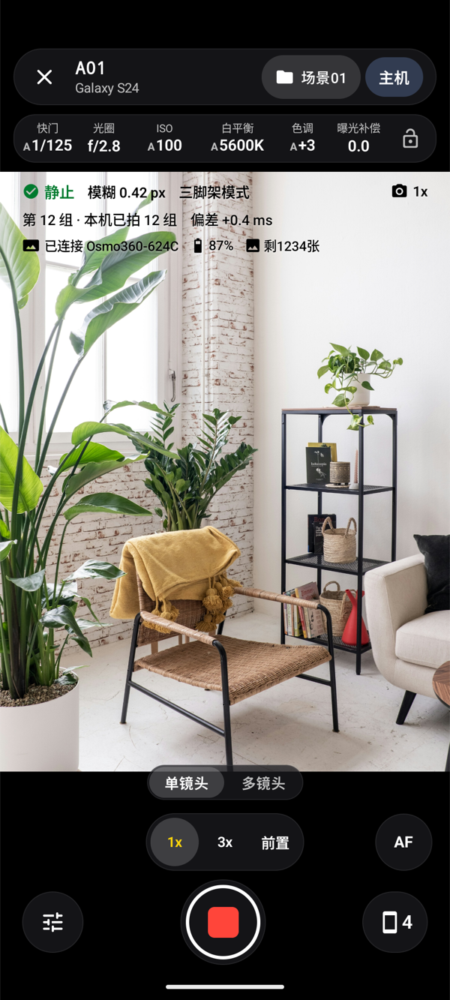
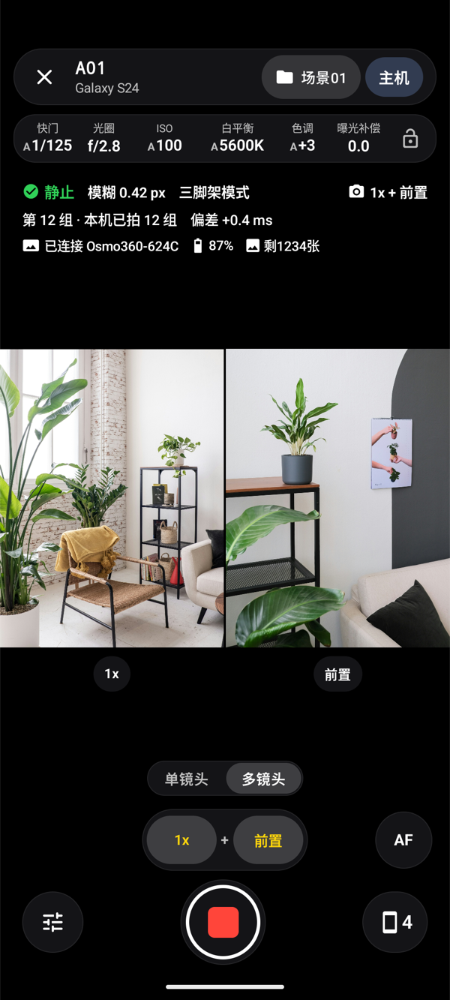
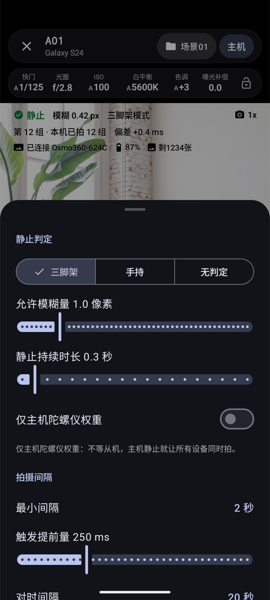
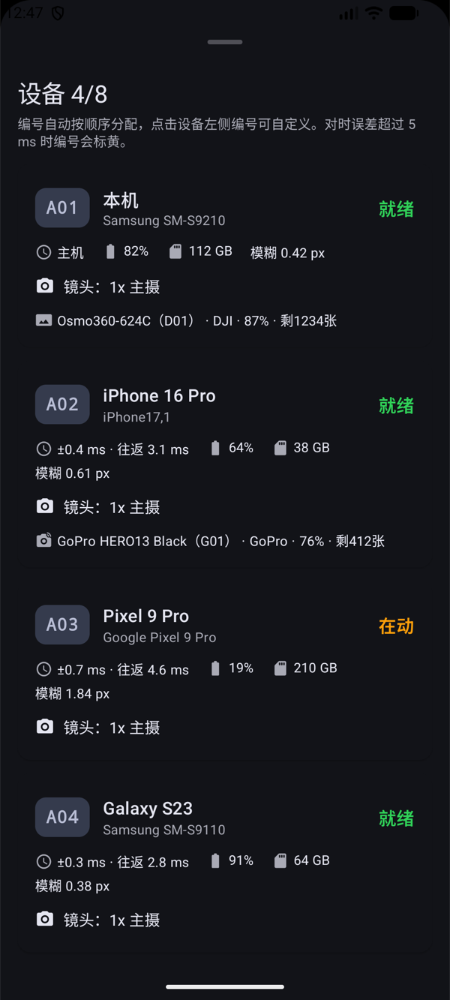

<p align="center">
  <picture>
    <source media="(prefers-color-scheme: dark)" srcset="docs/images/app-logo-dark.png">
    
  </picture>
</p>

<h1 align="center">齐拍即合 TuttiCam · Android</h1>

<p align="center">
  <b>简体中文</b> | <a href="README.en.md">English</a>
</p>

<p align="center">
  <a href="https://github.com/dtpoi/TuttiCam-Android/releases/latest"></a>
  <a href="https://github.com/dtpoi/TuttiCam-Android/actions/workflows/ci.yml"></a>
  <a href="https://apps.apple.com/app/id6820396336"></a>
  <a href="https://www.TuttiCam.com"></a>
</p>

多台手机组成一组，**在所有设备都稳定的同一时刻自动间隔拍照**，为 3D 高斯泼溅 与 大范围延时 所设计。

这是 iOS 版（[TuttiCam](https://apps.apple.com/app/id6820396336)）的安卓原生移植，网络协议与 iOS 兼容，**安卓和 iPhone 可以在同一个会话里同步间隔拍摄**，安卓与iOS版本都允许当作主机。

## 截图

| 单镜头 | 多镜头 | 静止判定设置 | 多设备与外接相机 |
| :---: | :---: | :---: | :---: |
|  |  |  |  |

## 功能

| &nbsp;&nbsp;&nbsp;&nbsp;&nbsp;&nbsp;&nbsp;&nbsp;&nbsp;功&nbsp;能&nbsp;&nbsp;&nbsp;&nbsp;&nbsp;&nbsp;&nbsp;&nbsp;&nbsp;&nbsp; | 说&nbsp;明 |
| --- | --- |
| 组队 | 一台当主机，其余当从机；同一 Wi‑Fi 或热点下用 NSD 自动发现，一个会话最多 8 台。指令走 TCP，对时和状态走 UDP。从机掉线后按 1、2、4…最多 30 秒自动重连 |
| 遥控模式 | 适合手机连接相机，充当外接相机的自动间隔快门器；画面中央可直接调静止判定和最小间隔 |
| 精确对时 | NTP 式往返测量，每轮 30 个探测取往返最短的一次；对时误差超过 5 ms 时编号标黄 |
| 按时刻取帧 | Camera2 连续输出全尺寸画面，取曝光开始时刻（`SENSOR_TIMESTAMP`）离约定时刻最近的一帧，偏差如实回报给主机 |
| 静止判定 | 陀螺仪估算模糊像素（角速度 × 快门 × 焦距）；三脚架、手持、不判定三种模式，可只看主机 |
| 强制照片同步 | 可选；有设备在动或没拍到时整组作废 |
| 手动参数 | 快门、ISO、白平衡（色温和色调）、曝光补偿、对焦（竖向刻度尺），可锁定全部参数；自动时显示实测值 |
| 多镜头 | 单镜头按实际倍率显示（如 0.6x、1x、3x、前置）；两颗后置走逻辑多摄的物理子镜头，后置加前置走并发相机，按能力探测列出 |
| 照片格式 | JPEG、HEIC、RAW（只存 DNG）、RAW + JPEG；多镜头和变焦切出的长焦不出 RAW，会在取景器上提示 |
| 照片信息 | EXIF（含 GPS）、可选的 XMP 拍摄姿态、可选的同名 JSON、每个场景的 `session.json`，字段与 iOS 相同 |
| 场景分组 | 每个场景一个文件夹，可新建、重命名（各设备同步改名）、切换 |
| 外接相机 | 通过蓝牙给外接相机按快门：DJI、索尼、佳能、富士、尼康、理光、GoPro。协议来源见[第三方声明](THIRD_PARTY_NOTICES.md)；安卓端还没有用真相机测试过 |
| 自适应布局 | 普通手机用上下布局；较宽的屏幕、折叠屏展开用侧栏布局，书本式折叠时避开折痕 |
| 多语言 | 简体中文、English、日本語；设置里可单独切换 App 语言（Android 13 起与系统的“应用语言”同步） |

所有计算都在设备上完成：没有账号和服务器，不接入广告、统计、崩溃收集 SDK，照片只保存在拍摄它的手机上。

## 系统要求

- Android 9（API 28）及以上，需要相机；有陀螺仪才能做静止判定。
- 已实测：三星 Galaxy S24（Android 16）。
- 与 iPhone 混拍：两端连同一个 Wi‑Fi 或热点，iOS 版 1.1 起。

## 构建

需要 JDK 21 和 Android SDK（compileSdk 37.2）。

```bash
./gradlew :app:assembleDebug
```

安装包在 `app/build/outputs/apk/debug/app-debug.apk`。也可以直接用 Android Studio 打开本目录运行。

```bash
./gradlew :protocol:test :app:testDebugUnitTest   # 单元测试
./gradlew :app:lintDebug                          # lint
```

## 工程结构

```
TuttiCam-Android/
├── protocol/        纯 Kotlin 模块：消息、编解码、对时、设置模型、外接相机协议；不依赖 Android，测试在电脑上跑
├── app/             Android 应用（包名 com.thinktough.tutticam）
│   └── src/main/java/com/thinktough/tutticam/
│       ├── app/         全局状态 AppModel、App 语言
│       ├── net/         局域网连接（NSD + TCP / UDP）
│       ├── engine/      主机调度、拍摄执行、静止判定、定位
│       ├── camera/      Camera2：能力探测、按时刻取帧、白平衡换算、JPEG / HEIC / DNG 编码
│       ├── storage/     场景文件夹、EXIF / XMP、记录文件
│       ├── accessory/   外接相机的蓝牙连接和各品牌驱动
│       └── ui/          Compose 界面
├── docs/            设计文档、网络协议、发布流程
├── tools/           应用图标生成、界面文字生成、iOS golden 报文工具
└── .github/         CI / 发布流程、Issue 和 PR 模板
```

## 与 iOS 互通

- 协议规范见 [docs/PROTOCOL.md](docs/PROTOCOL.md)。
- `protocol` 模块的测试用 iOS 原始模型代码生成的报文（`tools/ios-golden`）做双向编解码检查。
- 安卓专有的照片格式 `raw` 下发给 iPhone 时换成 `rawJpeg`。

## 照片输出

照片保存在 `Documents/TuttiCam/<场景名>_<日期>_<时间>/`，在“文件”App 和相册里都能看到：

```
r0001_A01_w.jpg     第 1 组、设备 A01、主摄（uw 超广角、w 主摄、t 长焦、f 前置）
r0001_A01_w.dng     RAW（选了 RAW 时）
r0001_A01_w.json    同名 JSON（打开“输出照片陀螺仪信息”时）
r0001_A01_D01.json  外接相机 D01 的触发记录
session.json        设备列表、本次设置、对时质量
```

## 文档

- [设计文档](docs/DESIGN.md)
- [网络协议](docs/PROTOCOL.md)
- [参与贡献](CONTRIBUTING.md)
- [更新日志](CHANGELOG.md)
- [发布流程](docs/RELEASING.md)
- [第三方声明](THIRD_PARTY_NOTICES.md)
- [许可证](LICENSE)

## 致谢

- 索尼、佳能、富士、尼康、理光的蓝牙遥控协议移植自 [furble](https://github.com/gkoh/furble)（MIT）。
- DJI 设备的蓝牙遥控依据 DJI R SDK 协议文档和 [Osmo GPS Controller Demo](https://github.com/dji-sdk/Osmo-GPS-Controller-Demo)。
- GoPro 相机的蓝牙遥控依据 [Open GoPro](https://github.com/gopro/OpenGoPro) 规范。

DJI、Osmo、Sony、Canon、EOS、FUJIFILM、Nikon、RICOH、GR、GoPro、HERO 是各自所有者的商标。本项目与这些公司没有关联，也未获得它们的认可。

## 许可证

本项目以 [GNU 通用公共许可证第 3 版（GPL-3.0）](LICENSE) 发布。你可以使用、修改和再发布，但再发布（包括修改后的版本）时必须同样以 GPL-3.0 公开全部源代码。
第三方组件仍按各自的许可证使用，见[第三方声明](THIRD_PARTY_NOTICES.md)。
